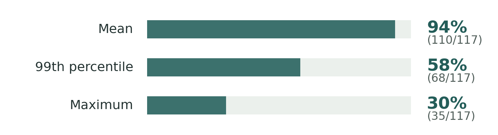
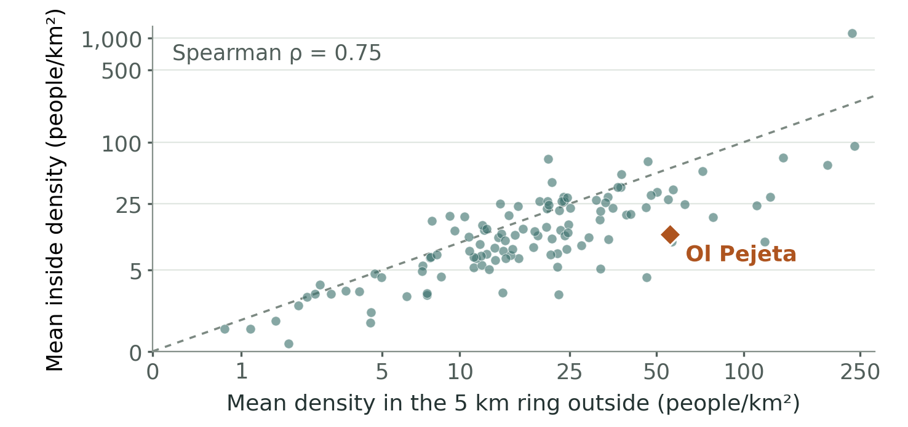
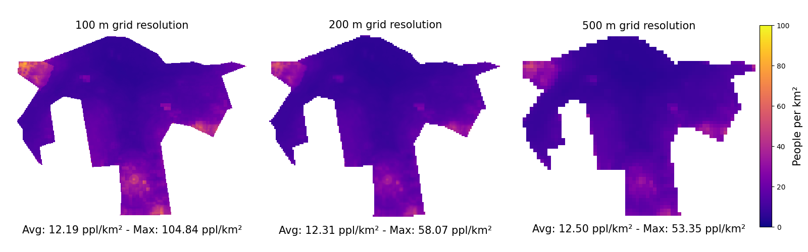

# WorldPop analysis for Ol Pejeta and Kenyan conservancies

This repository reproduces the residential population raster analysis in Section 4.3 of the dissertation. It covers the Ol Pejeta Conservancy (OPC) case study and a comparison across 117 Kenyan wildlife conservancies. The OPC scripts show how grid size changes the population density distribution. The Kenya scripts test how that distribution responds to the choice of summary statistic and how the mean density inside each conservancy relates to its surroundings.

## Inputs and installation

Use Python 3.10 or later. Download the [WorldPop 2020 Kenya unconstrained population-count raster](https://hub.worldpop.org/geodata/summary?id=6530) as `data/ken_ppp_2020.tif`. The file used in the dissertation has SHA-256 `728c26e3b6afcaf296b6090872ffaebfee230f801504be28d06a5a2d6c2f2b34`. This is a WGS 84 raster at three arc-seconds. Each pixel records an estimated number of people. The analysis assumes a **nominal cell area of 0.01 km²** (100 × 100 m) to match the dissertation. Grid sizes in metres and derived densities therefore use the same nominal convention.

```bash
python -m venv .venv
source .venv/bin/activate
python -m pip install -r requirements.txt
```

## Kenya comparison

Run from the repository root.

```bash
python scripts/kenya_conservancy_analysis.py
python scripts/kenya_conservancy_figures.py
```

The analysis writes `kenya_conservancy_stats.csv` and `kenya_conservancy_summary.json` under `outputs/kenya_conservancies/`. The figure script reads the CSV and writes PDFs and 300 dpi PNGs under `outputs/kenya_conservancies/figs/`. Use `--help` on either script for input and output overrides.

### Boundaries and raster masking

The default workflow queries the [KWCA Member Conservancies 2024 layer](https://www.arcgis.com/home/item.html?id=93c59aecc19c4b9aadb3701d867aa0c3). The dissertation snapshot contained 182 polygons. Six proposed and two uncertain entries were excluded by status. Of the operational, mature and emerging entries, 57 were below 50 km² after projecting each polygon into its local UTM zone. This left 117 conservancies. One invalid outline, Meibae, was repaired before measuring its area. The Ol Pejeta entry uses the original thesis polygon included as `data/operational_area.kml.kml`. All other retained geometries come from KWCA.

The script records the SHA-256 of the GeoJSON in its summary. The dissertation snapshot hashes to `06cec011fa0ee5ccd6bbe361faa56761baa20eda6752324ebaea9f03b5092c82`. To use an archived export, pass `--kwca path/to/export.geojson`. KWCA describes the outlines as indicative and the layer as a dated and incomplete snapshot. [KWCA mapping notes](https://kwcakenya.com/resources/maps-and-gis/)

1. Assign each native WorldPop pixel to the inside mask if its centre falls inside the conservancy polygon. Keep valid zero values and exclude NoData.
2. Group the native pixels into 1 × 1, 2 × 2 or 5 × 5 blocks aligned to the origin of the national raster. This gives nominal 100, 200 and 500 m grids. Divide the sum of the counts in each block by the nominal area represented by its valid inside pixels. At the edge, an incomplete block uses only those contributing pixels.
3. Compute the inside mean as total population divided by represented inside area. Compute the percentiles and maximum across the valid block densities. Classify a peak block as an edge maximum when its centre lies outside the core, defined as the polygon eroded by 1 km. This includes partial blocks whose centres lie just outside the polygon. The CSV records peak ties, full-block maxima and raster coverage for sensitivity checks.
4. In local UTM, buffer each polygon by 5 km and remove its interior to define the outside ring. Mask that ring separately and divide its valid counts by their represented area. Compare the paired inside and outside means using Spearman rank correlation.

### Results at nominal 200 m

| Interior statistic | Median across conservancies (people/km²) | Conservancies below 50 people/km² |
|---|---:|---:|
| Mean | 11.84 | 110 of 117 (94%) |
| 99th percentile | 36.92 | 68 of 117 (58%) |
| Maximum | 88.30 | 35 of 117 (30%) |



The maximum was typically 1.84 times the 99th percentile and exceeded twice that percentile in 53 conservancies. Coarsening from 100 to 500 m reduced the maximum by more than one third in 21 conservancies. At 200 m, the peak was in the inner 1 km band in 95 conservancies. The median inside mean among conservancies in the lowest quartile of surrounding density was 3.06 people/km².



*Figure 4.4 comparison. The dashed diagonal shows equal inside and outside density. Spearman ρ = 0.7473 for the 117 paired means.* [View median and interquartile ranges](figs/kenya/02_typical_density_ranges.png).

### Interpretation

The raster models residential population. Tourist presence, staff movements and accommodation hotspots require separate evidence. A large gap between the maximum and the 99th percentile can flag an isolated peak for inspection. The association between interior and surrounding density is consistent with settlement spillover, but the paired values come from the same raster and cannot establish the cause of an individual peak. The 50 people/km² comparison illustrates sensitivity to the choice of statistic. An operational assessment uses the relevant operational and ground-risk areas. [JARUS SORA v2.5](https://jarus-rpas.org/publications/)

The figure uses all 117 conservancies without a coverage screen. This includes Pate Marine, where only 3.97% of the interior native cells have valid data and the largest 200 m block estimate has one valid contributing pixel. The national layer dates to 2024 and the raster models 2020. Boundary changes, grid alignment and partial cells can affect individual results.

## Ol Pejeta case study

The legacy OPC workflows use the bundled KMLs and the same raster. Run from the repository root.

```bash
python scripts/opc_multigrid_density_maps.py
python scripts/adjacent_ring_multigrid_density.py
python scripts/operational_density_distribution.py
```

The first script displays the 100, 200 and 500 m maps and reports summary statistics. The second saves adjacent-area figures under `figs/`, using the bundled 5 km buffer around the contingency volume. The third writes an OPC density histogram at native resolution. The original OPC workflow groups cells from the origin of the clipped window. The Kenya workflow uses the national raster origin, which can give slightly different block maxima for the same site.



[OPC density distribution](figs/operational_density_distribution.png) · [5 km adjacent area at 200 m](figs/adjacent_area_200m.png)

## Data and funding

The code is MIT. Cite [WorldPop and CIESIN](https://doi.org/10.5258/SOTON/WP00645) and the [Kenya Wildlife Conservancies Association](https://kwcakenya.com/resources/maps-and-gis/) when reusing the analysis. Download the source raster and the Kenya boundary layer from their providers. The figures in this repository contain derived summary statistics.

This work was funded by the European Union’s Horizon Europe research and innovation programme under the Marie Skłodowska-Curie grant agreement no. 101071224.
